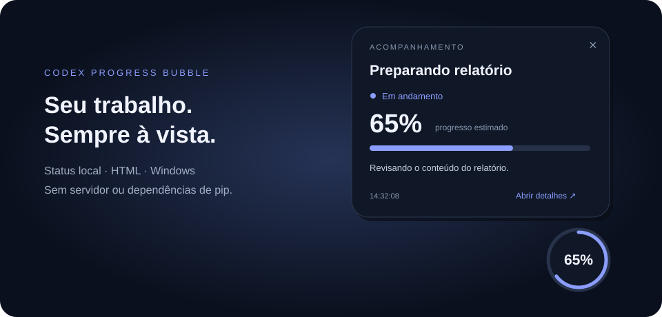

<div align="center">

# 🫧 Progress Bubble

### Seu agente trabalha. Você acompanha.

Acompanhamento automático para seu agente, com uma bolinha no desktop, progresso visível e tempo restante estimado.

**Codex · Claude Code · Google Antigravity**

[](https://github.com/EvandroSilvaPinto/progress-bubble/actions/workflows/tests.yml)
[](https://www.python.org/downloads/)
[](LICENSE)

[Começar agora](#-comece-em-3-comandos) · [Como funciona](#-do-pedido-à-entrega) · [Agentes compatíveis](#-uma-skill-três-agentes)

</div>



## ✨ Menos troca de janelas. Mais clareza.

Pediu uma tarefa e foi fazer outra coisa? O **Progress Bubble** deixa o andamento visível sobre as outras janelas. Quando quiser mais contexto, basta clicar na bolinha.

| À primeira vista | Ao clicar |
| --- | --- |
| 🫧 Percentual e anel de progresso | 📋 Status, mensagem e tempo restante |
| 🎨 Cores para conclusão, falha ou espera | 📊 Barra de progresso estimado |
| 🖱️ Arraste para onde preferir | 🔗 Volte à conversa ou abra os detalhes em HTML |

**Local por padrão.** Os scripts não enviam telemetria nem precisam de servidor, conta adicional ou dependências de pip.

> **Antes de instalar:** a bolinha precisa de **Windows nativo + Python 3.10 ou superior com Tkinter**. Em macOS, Linux, WSL e ambientes sem desktop, o acompanhamento pode ser usado em HTML.

## 🚀 Comece em 3 comandos

Com Git e Python instalados, abra o terminal:

```powershell
git clone https://github.com/EvandroSilvaPinto/progress-bubble.git
cd progress-bubble
python install.py --agent all
```

Pronto: a skill é copiada para as pastas pessoais dos três agentes. Recarregue as skills ou inicie uma nova sessão. A instrução padrão é aplicá-la automaticamente em toda interação, sem precisar chamar um comando.

**Prefere instalar em apenas um?**

```powershell
python install.py --agent codex
python install.py --agent claude
python install.py --agent antigravity
```

Escolha a linha do seu agente. O instalador preserva instalações existentes: se o destino já existir, ele para e informa o caminho.

## 🤝 Uma skill, três agentes

| Agente | Para chamar a skill | Instalação pessoal/global |
| --- | --- | --- |
| **Codex** | `$progress-bubble` | `~/.agents/skills/` |
| **Claude Code** | `/progress-bubble` | `~/.claude/skills/` |
| **Google Antigravity** | `/progress-bubble` | `~/.gemini/config/skills/` |

O mesmo `SKILL.md` e os mesmos scripts atendem aos três. O suporte a Claude é para **Claude Code local**; esta instalação não adiciona uma extensão ao chat web do Claude nem sincroniza skills para Cowork.

<details>
<summary><strong>Instalar em um projeto, conferir os destinos ou usar o skill-installer</strong></summary>

Instalação apenas no projeto escolhido:

```powershell
python install.py --agent all --scope project --project-root "C:/caminho/do/projeto"
```

Codex e Antigravity compartilham `.agents/skills/` no projeto. Claude Code usa `.claude/skills/`.

Veja os destinos sem copiar arquivos:

```powershell
python install.py --agent all --dry-run
```

No Codex, também é possível pedir:

> Use $skill-installer para instalar https://github.com/EvandroSilvaPinto/progress-bubble/tree/main/skills/progress-bubble

Para instalar manualmente, copie a pasta inteira `skills/progress-bubble` para o destino do seu agente. `agents/openai.yaml` contém metadados opcionais do Codex.

Para atualizar uma instalação existente, faça backup e mova a pasta anterior antes de reinstalar. Se já usa `~/.codex/skills/` no Codex, atualize essa cópia em vez de criar outra. Evite duplicar instalações pessoais e de projeto.

Em macOS/Linux, use `python3` se necessário. Os caminhos do Antigravity seguem a documentação atual; versões antigas podem usar caminhos legados. No Antigravity CLI, `/skills reload` recarrega as skills.

</details>

## 🔄 Do pedido à entrega

**1. Instale e faça seu pedido.** A skill orienta o agente a aplicá-la em **toda interação**, sem invocação explícita. A bolinha e o HTML são criados quando a tarefa for estimada em mais de **30 segundos**, ou ultrapassar esse tempo durante a execução. Pedidos rápidos passam apenas pela verificação inicial.

**2. Continue o seu dia.** A bolinha mantém o percentual à vista. Clique para expandir o cartão; arraste para mudar de posição.

**3. Confira o resultado.** Ao concluir e verificar a entrega, o agente marca **100%**. A bolinha fica disponível até você fechá-la com **×** ou iniciar outra interação no mesmo chat. Nesse momento, o agente fecha o acompanhamento concluído anterior e preserva o HTML. Fechar a janela não cancela o trabalho.

> **Progresso estimado, sem falsa precisão.** Quem atualiza o andamento é o agente. O limite de 30 segundos é uma instrução de uso, não um cronômetro que intercepta todas as tarefas. A descrição solicita uso automático, e o Codex permite invocação implícita. A seleção efetiva depende de o agente carregar e seguir a skill; a instalação não cria um serviço em segundo plano nem força o modelo a executá-la. Se ela não aparecer, recarregue as skills ou inicie uma nova sessão.

Para reforçar o uso nas instruções permanentes do seu agente, adicione:

> Aplique a skill progress-bubble no início de toda interação, sem invocação explícita. Feche acompanhamentos concluídos deste chat e crie progresso para demandas estimadas acima de 30 segundos ou que ultrapassem esse tempo.

Use `AGENTS.md` no Codex, `CLAUDE.md` no Claude Code ou as regras do Antigravity, conforme sua configuração.

## 🎨 Do seu jeito

Clique em **Cores** para abrir cinco bolinhas centralizadas acima do acompanhamento. Passe o mouse para ver o tooltip e clique para escolher a cor:

| Cor | O que muda |
| --- | --- |
| **Fundo** | Cartão e bolinha |
| **Texto** | Títulos, percentual e mensagens |
| **Progresso** | Anel e barra |
| **Detalhes** | Links e tempo restante |
| **Estados** | Conclusão, falha e espera |

A escolha é aplicada e salva imediatamente para os próximos acompanhamentos. Os estados também usam símbolos e texto. A logo verde mantém a identidade do projeto.

**Tempo restante discreto:** veja algo como “Faltam cerca de 3 min”, sem horário exato de término. A estimativa é informada pelo agente e pode ser revista durante a execução.

**Volte ao chat:** quando a origem estiver disponível, **Abrir conversa** leva à conversa da demanda. Caso contrário, **Abrir detalhes** abre o HTML. A janela flutuante permanece fora da barra de tarefas e do Alt+Tab.

## 🧪 Experimente antes de usar com o agente

Na pasta deste repositório, abra uma demonstração:

```powershell
python skills/progress-bubble/scripts/status.py --output outputs/demo.html --title "Preparando relatório" --percent 35 --message "Organizando o conteúdo" --eta-minutes 3 --open
```

Atualize a mesma demonstração:

```powershell
python skills/progress-bubble/scripts/status.py --output outputs/demo.html --title "Preparando relatório" --percent 100 --status "Concluído" --message "Relatório entregue e verificado"
```

Sem `--open`, o comando gera apenas o HTML e o JSON. Abra o HTML no navegador para acompanhar.

<details>
<summary><strong>Requisitos, estados e frequência de atualização</strong></summary>

- **HTML/JSON:** Python 3.10+ e navegador para visualizar a página.
- **Bolinha:** Windows nativo, sessão gráfica, Tkinter e `pythonw.exe`. `python -m tkinter` abre uma janela de teste.
- **Agente:** suporte a skills e permissão para gravar arquivos e executar Python. A instalação não altera permissões nem instala Python.
- **Atualizações:** o agente busca salvar avanços aproximadamente a cada 30 segundos; a bolinha lê os dados a cada 0,5 segundo e o HTML ativo recarrega a cada 1 segundo. A contagem do tempo restante se atualiza na interface; o percentual depende de avanços salvos pelo agente.
- **Chamadas longas:** ferramentas bloqueantes podem impedir atualizações intermediárias. Visualizadores de HTML incorporados podem exigir recarga manual.
- **Estados:** `Em andamento`, `Aguardando informação`, `Concluído`, `Interrompido` e `Falha`. Somente `Concluído` aceita 100%; em falha, preserve o percentual alcançado.
- **Personalização:** altere o limite no `SKILL.md` e na descrição de `agents/openai.yaml`. Não há informação de última atualização na interface.

</details>

<details>
<summary><strong>Privacidade, execução remota e solução de problemas</strong></summary>

Os dados ficam nos arquivos do caminho escolhido. O botão de detalhes abre o HTML no navegador padrão; quando disponível, o link da conversa abre o aplicativo ou site de origem. Evite colocar credenciais ou informações sensíveis no título e na mensagem; não publique acompanhamentos reais.

Cada demanda deve usar um arquivo diferente. Uma nova abertura para o mesmo JSON não duplica a janela. Não há inicialização automática com o Windows nem execução de trabalho após o encerramento do agente. Textos extensos são resumidos no cartão e preservados no HTML.

Em WSL, contêineres e agentes remotos, use o HTML. Executar um script remoto não abre uma janela no desktop local. As permissões e políticas do seu ambiente continuam valendo.

Se a bolinha não aparecer, confirme os requisitos e execute no terminal para ver o erro:

```powershell
python skills/progress-bubble/scripts/bubble.py outputs/demo.json
```

Os scripts são resolvidos a partir da pasta da skill instalada, sem caminhos pessoais fixos. No Claude Code, `${CLAUDE_SKILL_DIR}` também pode identificar essa pasta. Use `python`, `python3` ou `py -3` conforme o interpretador disponível.

</details>

## 🛠️ Feito para compartilhar e evoluir

Os testes cobrem instalação nos três destinos, execução após mover a skill, preservação de arquivos existentes, caracteres especiais, estados e conclusão. O CI roda em **Windows e Linux**, com **Python 3.10 e 3.13**.

```powershell
python -m unittest discover -s tests -v
```

**O que foi validado:** instalador, scripts e caminhos documentados. A janela foi inspecionada manualmente no Windows com Python 3.13. A seleção automática ainda precisa ser conferida numa sessão de cada agente.

Encontrou um problema ou tem uma ideia? [Abra uma issue](https://github.com/EvandroSilvaPinto/progress-bubble/issues). Pull requests são bem-vindos. Informe sistema, versão do Python, comando e resultado esperado, sem anexar dados privados.

Se o projeto ajudou você, uma **⭐ no repositório** ajuda outras pessoas a encontrá-lo.

---

**Licença [MIT](LICENSE)** · Projeto independente, sem afiliação oficial com OpenAI, Anthropic ou Google.

Referências de instalação: [Codex](https://learn.chatgpt.com/docs/build-skills) · [Claude Code](https://code.claude.com/docs/en/skills) · [Antigravity](https://antigravity.google/docs/skills). Caminhos conferidos em 13/11/2026.
