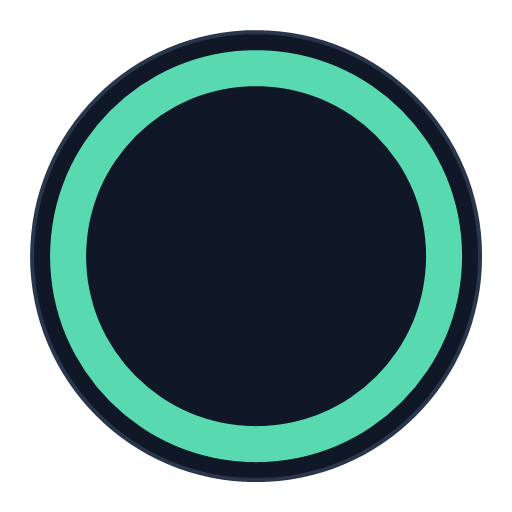
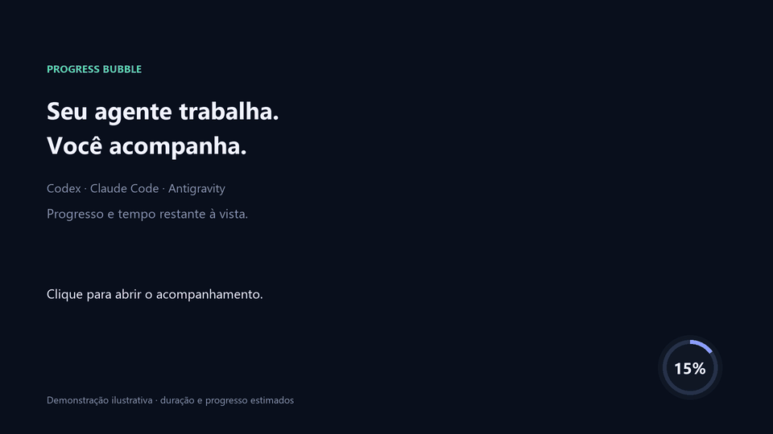

<div align="center">



# 🫧 Progress Bubble

### Your agent works. You stay in the loop.

Automatic progress tracking for your AI agent, with a floating desktop bubble, visible progress and estimated time remaining.

**Codex · Claude Code · Google Antigravity**

[](https://github.com/EvandroSilvaPinto/progress-bubble/actions/workflows/tests.yml)
[](https://www.python.org/downloads/)
[](LICENSE)

[Get started](#get-started) · [How it works](#how-it-works) · [Supported agents](#supported-agents)

</div>



<p align="center"><sub>Illustrative demonstration. Progress and time remaining are estimated by the agent.</sub></p>

## ✨ Fewer window switches. More clarity.

Asked your agent to work on something while you focus elsewhere? **Progress Bubble** keeps progress visible above your other windows. Click the bubble whenever you want more context.

| At a glance | On click |
| --- | --- |
| 🫧 Percentage and progress ring | 📋 Status, message and time remaining |
| 🎨 Completion, failure and waiting colors | 📊 Estimated progress bar |
| 🖱️ Drag it wherever you prefer | 🔗 Return to the chat or open HTML details |

**Local by default.** Runtime scripts send no telemetry and need no server, extra account or pip dependencies.

> **Before installing:** the floating bubble requires **native Windows + Python 3.10 or later with Tkinter**. On macOS, Linux, WSL and environments without a desktop, use the HTML progress page.

## 🌐 Automatic language detection

The interface detects the system language when it starts:

| System language | Interface language |
| --- | --- |
| Portuguese, including Brazil and Portugal | Portuguese |
| English | English |
| Other or unidentified languages | English |

Windows detection uses the **user's display language**, rather than regional date and number formats. On other systems, HTML generation follows `LC_ALL`, `LC_MESSAGES`, `LANGUAGE` or `LANG`, in that order, falling back to Python's locale.

Buttons, menus, size labels, statuses, tooltips, notices and time remaining are translated. HTML pages use matching language attributes, accessible labels and countdown text. Task titles and messages preserve the text supplied by the agent. The native color chooser follows Windows.

No translation downloads or configuration are required. After updating the skill or changing the system language, close old bubbles and open a new tracker. Technical status values in JSON and `--status`, and existing preference keys, remain compatible with earlier versions.

<a id="get-started"></a>

## 🚀 Get started in 3 commands

With Git and Python installed, open a terminal:

```powershell
git clone https://github.com/EvandroSilvaPinto/progress-bubble.git
cd progress-bubble
python install.py --agent all
```

The skill is copied into all three agents' personal skill folders. Reload skills or start a new agent session. Its instructions request automatic use in every interaction, without an explicit command.

**Only need one agent?** Choose its command:

```powershell
python install.py --agent codex
python install.py --agent claude
python install.py --agent antigravity
```

The installer protects existing installations: it stops and displays the path if a destination already exists. Use the update commands below to replace it with a backup.

<a id="supported-agents"></a>

## 🤝 One skill, three agents

| Agent | Explicit invocation | Personal/global installation |
| --- | --- | --- |
| **Codex** | `$progress-bubble` | `~/.agents/skills/` |
| **Claude Code** | `/progress-bubble` | `~/.claude/skills/` |
| **Google Antigravity** | `/progress-bubble` | `~/.gemini/config/skills/` |

The same `SKILL.md` and runtime scripts serve all three. Claude support targets **local Claude Code**, not Claude's web chat or skill synchronization to Cowork.

<details>
<summary><strong>Project installation, destination previews and skill-installer</strong></summary>

Install only in a specific project:

```powershell
python install.py --agent all --scope project --project-root "C:/path/to/project"
```

Codex and Antigravity share `.agents/skills/` in a project; Claude Code uses `.claude/skills/`.

Preview destinations without copying files:

```powershell
python install.py --agent all --dry-run
```

In Codex, you can also ask:

> Use $skill-installer to install https://github.com/EvandroSilvaPinto/progress-bubble/tree/main/skills/progress-bubble

For manual installation, copy the entire `skills/progress-bubble` folder into your agent's skill directory. `agents/openai.yaml` provides optional Codex metadata.

Existing Codex installations in `~/.codex/skills/` are updated in place. If both Codex locations contain a copy, resolve the duplicate before continuing. On macOS/Linux, use `python3` if needed. Older Antigravity versions may use legacy paths; in Antigravity CLI, `/skills reload` reloads skills.

</details>

## 🔄 Update with one command

From your cloned repository's folder, run:

```powershell
python update.py --agent all
```

To update one agent, replace `all` with `codex`, `claude` or `antigravity`:

```powershell
python update.py --agent codex
```

This fetches the latest version with `git pull --ff-only` and updates skills, installing missing ones as well. If Git cannot update the repository, installed skills remain unchanged. Resolve conflicting local changes before retrying. Fetching updates requires Git and internet access.

**Automatic backup:** the entire previous installation is saved in `progress-bubble-backups/`, next to the `skills/` directory. The terminal prints its location. Skill-file customizations remain in the backup and are not merged automatically. Colors in `ProgressBubble/colors.json` are preserved. If replacing an installation fails, that installation is restored; updates already completed in other destinations remain in place.

Reload skills or start a new agent session afterwards. Open bubbles retain their loaded version until closed and reopened.

<details>
<summary><strong>Update a project, preview changes or use a downloaded copy</strong></summary>

```powershell
python update.py --agent all --scope project --project-root "C:/path/to/project"
python update.py --agent all --dry-run
```

A dry run only displays destinations, without downloads or file changes. If you downloaded the latest ZIP instead of cloning, open the extracted folder and run:

```powershell
python install.py --agent all --update
```

This uses local files without fetching updates. To restore a backup manually, close bubbles, move the current installation to a separate backup folder and return the saved version to its original path. Then reload skills.

</details>

<a id="how-it-works"></a>

## 🔄 From request to delivery

**1. Install and ask for your work.** The skill instructs the agent to apply it in **every interaction**, without explicit invocation. A bubble and HTML page are created for tasks estimated to take more than **30 seconds**, or that exceed this time during execution. Quick requests only need the initial check.

**2. Keep going with your day.** Click the bubble to expand its card; drag to reposition it.

**3. Check the result.** Once delivery is complete and verified, the agent marks **100%**. The **card's ×** only collapses the card. To close the bubble, hover over it and click the **× above and outside its upper-right corner**. Completed trackers also close when a new interaction begins in the same chat; their HTML remains available. Closing a window does not cancel the task.

> **Estimated progress, without false precision.** The agent supplies updates. The 30-second threshold is an instruction, not a system timer intercepting tasks. The description requests automatic use, and Codex permits implicit invocation. Actual selection depends on the agent discovering and following the skill. Installation does not create a background service or force the model to run it. If it does not appear, reload skills or start a new session.

To reinforce the preference in permanent instructions, add:

> Apply the progress-bubble skill at the start of every interaction, without explicit invocation. Close completed trackers from this chat and create progress tracking for tasks estimated to take more than 30 seconds or that exceed that time.

Use `AGENTS.md` for Codex, `CLAUDE.md` for Claude Code or Antigravity rules, according to your setup.

## 🎨 Make it yours

Click **Colors** to reveal five centered circles above the card. Hover for a tooltip and click to choose a color:

| Color | Controls |
| --- | --- |
| **Background** | Card and bubble backgrounds |
| **Text** | Titles, percentage and messages |
| **Progress** | Ring and bar |
| **Details** | Links and time remaining |
| **States** | Completion, failure and waiting |

Choices are applied and saved immediately. **Reset colors** appears beside **Colors**, with spacing, only while the palette is visible. It restores every default shade, including derived and state colors. Other open trackers receive the changes on their next refresh. Statuses also use symbols and text. The green logo retains its original colors.

**Three sizes, two independent settings:** click **Sizes** in the card, or right-click the bubble. Choose **Small**, **Medium** or **Large** in each group:

- **Card and colors:** scales the card, its text and palette together.
- **Bubble:** scales the ring, percentage and its close button.

Medium uses the default scale; Small uses 85% and Large uses 120%, respecting Windows display scaling. Choices are stored in `sizes.json`, next to `colors.json`, and shared across trackers. Resetting colors preserves sizes. On Windows, menu callbacks remain available until the selected command runs. Close old bubbles and open a new tracker after updating.

**Sharper rendering:** color circles, card corners, the bar and close button use antialiased edges at their selected size and Windows scale. Text uses whole-pixel dimensions. Rendering uses the Python standard library with caching and no extra runtime dependencies.

**Parallel tasks:** new trackers open offset to the left, with space between bubbles. When a row reaches the screen edge, the next starts above it. Free positions are reused. You can still drag each tracker; opening another does not move existing windows. Position allocation requires bubbles opened with this version; close and reopen older ones.

**Discreet time remaining:** see “About 3 min left”, without an exact finish time. The agent supplies the estimate and can revise it as work progresses.

**Return to the chat:** **Open chat** opens the task's conversation when an origin link is available; otherwise, **Open details** opens the HTML. The floating window stays out of the taskbar and Alt+Tab.

## 🧪 Try it before using it with an agent

From the repository folder, open a demo:

```powershell
python skills/progress-bubble/scripts/status.py --output outputs/demo.html --title "Preparing report" --percent 35 --message "Organizing the content" --eta-minutes 3 --open
```

Update the same demo:

```powershell
python skills/progress-bubble/scripts/status.py --output outputs/demo.html --title "Preparing report" --percent 100 --status "Concluído" --message "Report delivered and verified"
```

`--status` uses Portuguese technical values even when the interface is English. Without `--open`, the command only generates HTML and JSON. Open the HTML in a browser to follow progress.

<details>
<summary><strong>Requirements, statuses and refresh frequency</strong></summary>

- **HTML/JSON:** Python 3.10+ and a browser.
- **Bubble:** native Windows, a graphical session, Tkinter and `pythonw.exe`. `python -m tkinter` opens a test window.
- **Agent:** skill support and permission to write files and execute Python. Installation does not change permissions or install Python.
- **Updates:** the agent aims to save real advances roughly every 30 seconds. The bubble reads saved data every 0.5 seconds; active HTML refreshes every second. The remaining-time counter updates in the interface; percentages depend on updates saved by the agent.
- **Long calls:** blocking tools may prevent intermediate updates. Embedded HTML viewers may require manual refreshes.
- **Status arguments:** `Em andamento` (In progress), `Aguardando informação` (Waiting for information), `Concluído` (Completed), `Interrompido` (Stopped) and `Falha` (Failed). Only `Concluído` accepts 100%; on failure, preserve the percentage reached.
- **Customization:** adjust the threshold in `SKILL.md` and keep discovery metadata consistent. No last-update timestamp is shown.

</details>

<details>
<summary><strong>Privacy, remote execution and troubleshooting</strong></summary>

Data stays at your chosen file location. Details open in the default browser; chat links open their original app or website. Avoid credentials or sensitive information in titles and messages. Do not publish real tracking files.

Use a different file for each task. Reopening the same JSON does not duplicate its window. The skill does not start with Windows or continue working after the agent stops. Long text is shortened in the card and preserved in HTML.

In WSL, containers and remote agents, use HTML. A remote script does not open a window on your local desktop. Your environment's permissions and policies still apply.

If the bubble does not appear, check requirements and run it in a terminal to see errors:

```powershell
python skills/progress-bubble/scripts/bubble.py outputs/demo.json
```

Scripts are resolved relative to the installed skill folder, without fixed personal paths. In Claude Code, `${CLAUDE_SKILL_DIR}` can identify that folder. Use `python`, `python3` or `py -3`, depending on the interpreter.

</details>

## 🛠️ Built to share and improve

Every project change must include a README update in the same delivery, as recorded in `AGENTS.md`. The optional GIF generator, `tools/render_demo.py`, uses Pillow only to create the image; the skill itself has no pip dependencies.

Tests cover installation for all three agents, relocated installations, existing-file protection, backups and updates, special characters, statuses, completion, colors, sizes, language detection, rendering and parallel placement. CI runs on **Windows and Linux**, with **Python 3.10 and 3.13**.

```powershell
python -m unittest discover -s tests -v
```

**Validation scope:** installer, scripts and documented paths. The window has been inspected manually on Windows with Python 3.13. Automatic skill selection still needs checking in a session of each agent.

Found a problem or have an idea? [Open an issue](https://github.com/EvandroSilvaPinto/progress-bubble/issues). Pull requests are welcome. Include your operating system, Python version, command and expected result, without private data.

If this project helps you, a **⭐ on the repository** helps others find it.

---

**[MIT License](LICENSE)** · Independent project, not officially affiliated with OpenAI, Anthropic or Google.

Installation references: [Codex](https://learn.chatgpt.com/docs/build-skills) · [Claude Code](https://code.claude.com/docs/en/skills) · [Antigravity](https://antigravity.google/docs/skills). Paths checked on November 13, 2026.
